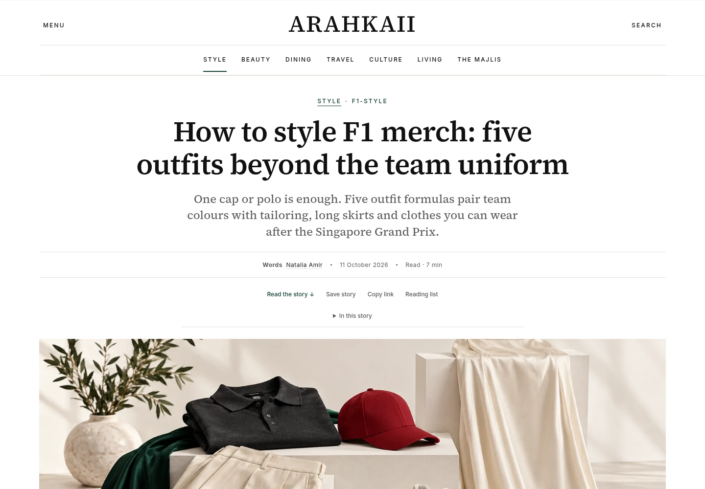

# F1 evergreen editorial release — 11 October 2026

Five linked guides and a topic hub, prepared for the Singapore race-weekend finale. User requested high-quality content, images and immediate publication; separately confirmed that illustrations should be used because licensed photos were unavailable.

## Editorial decisions

- Merch pillar: five complete outfit formulas and six team-colour starting points. No claims that generic illustrated products are official merchandise.
- Footwear: practical fitting and route checklist. The requested 20,000 steps is identified as a planning scenario, not a measured event statistic. No blister-free or product-testing claims.
- Beauty: humidity-aware planning, manufacturer examples and sun-protection guidance. No invented wear test or sweat-proof guarantee. Distinguish products used at home from the event's restrictions on spray cans and glass.
- Paddock: evergreen illustrated styling proposals. No fabricated driver/partner outfit identifications or purported event photographs.
- Shopping: adidas Singapore listing prices checked on 11 October 2026; actual organiser dates for Raffles City and Funan; Ray-Ban event dates and location checked against the event site and Singapore Tourism Board. No unverified Ferrari SGD price, stock guarantee, invented discount or affiliate link.

Each article records its AI-assisted desk-research method, citations, verification date and image disclosure. Dated 2026 activations sit in their own table; evergreen URLs and wardrobe advice continue to work after the event. Illustrations are credited both as heroes and inline.

## Visuals

Five original native 1672×941 images; high-quality WebP exports at the same dimensions. PNG masters retained separately. See image-provenance.json for hashes and representation notes. The generator did not supply a larger native size, so no 4K or upscaled-quality claim is made.

## Validation

`npm run verify` passed: 19 publishing tests, Astro diagnostics, redirects/content, production build, 573 valid JSON-LD blocks and 125 pages checked for links, semantics, image dimensions and sitemap parity. Focused Chromium checks and hosted-preview/production checks are recorded in the PR.

## Rollback

Previous production: ac6c86991c4ff8e2d96a18a87976217e3dfcd9b9, Vercel deployment dpl_GpMw3VHHTiaoBYSZm24zBhve39X7. Revert the editorial release through the repository if needed. No database or environment changes.
